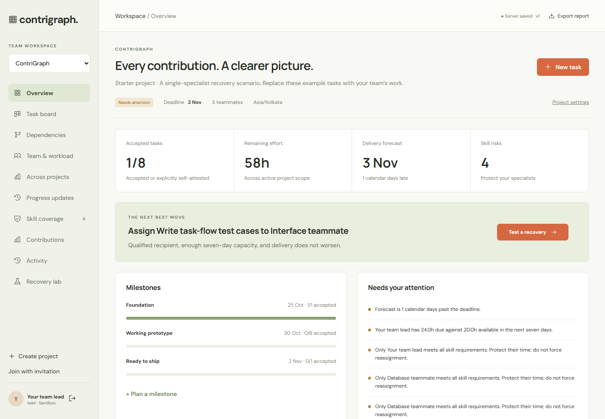
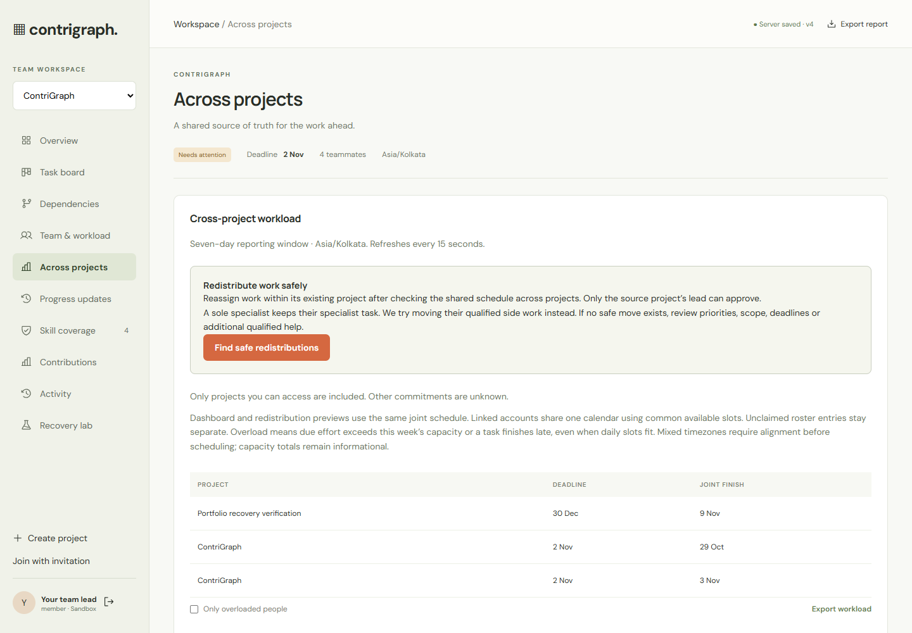
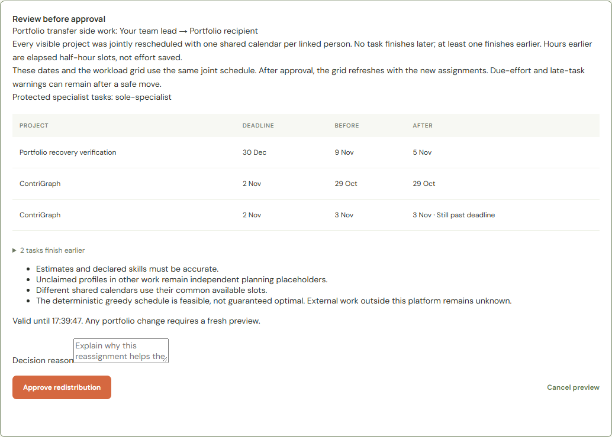

# ContriGraph

Project planning for student teams where skills, dependencies, and shared capacity determine what can actually ship.

ContriGraph makes workload visible across projects and previews safe recovery decisions before a lead approves them. When only one teammate has a required skill, that specialist keeps the task while compatible side work can move.



[Setup](#run-locally) · [Screenshot gallery](docs/SCREENSHOTS.md) · [Scheduling research](docs/RESEARCH.md) · [Contributing](CONTRIBUTING.md)

The main application is **`apps/web/` + `services/api/`**. The older browser-only prototype is kept outside this public repository.

## Run locally

Prerequisites: Node.js 22+ and Python 3.13.

```powershell
npm install
python -m venv services/api/.venv
services/api/.venv/Scripts/python.exe -m pip install -r services/api/requirements.txt
# Copy services/api/.env.example and apps/web/.env.example to their ignored local env files, then fill the settings.
npm run dev
```

Open **http://127.0.0.1:3000**. The web app proxies `/api` to FastAPI on port 8000. API documentation: http://127.0.0.1:8000/docs.

Create your own ignored environment file from `.env.example`. Configure Clerk using [the account setup guide](docs/google-login.md). Set the public key in `apps/web/.env.local` and the secret key and issuer in the API environment. Google and email authentication are managed by Clerk. Clerk mode disables the legacy sandbox login. Automated tests use isolated local accounts and sample workspaces. With `DATABASE_URL` empty, the API uses local SQLite; supplying a Postgres connection requires the migration below.

On macOS/Linux, activate the virtual environment with `source services/api/.venv/bin/activate`, then run `python -m pip install -r services/api/requirements.txt`. The npm launcher detects the platform automatically.

## What works

- Google and verified email registration/sign-in through Clerk. FastAPI verifies session signatures, issuer, expiry, and allowed origin before authorizing project access. Legacy local accounts remain available for isolated development tests only.
- Project creation, membership invitations, lead/member/reviewer permissions, milestones, deadlines, priorities, task estimates, and remaining effort.
- Task planning, prerequisite editing, cycle rejection, status transitions, reviewer acceptance, comments, evidence categories, file uploads/downloads, and append-only activity history.
- Member skills, weekly capacity, working days, time-off overrides, and project holidays.
- Deterministic half-hour resource scheduling, dependency propagation, overdue alerts, missing-skill and single-specialist detection, and conditional/unknown forecasts.
- Recovery previews for qualified reassignment, priority, scope deferral, capacity, and deadline changes. Approval records a reason and the forecast change.
- Contribution dimensions for accepted estimated effort, deliverables, independent reviews, documentation, and blocker evidence. No member ranking or invented productivity score.
- Five-second background revision checks, optimistic edit conflict protection, and JSON performance-report export.
- Across projects: seven-day workload for accessible projects, shared-account capacity counted once, daily overload warnings, unclaimed/unassigned work, calendar-conflict warnings, task drilldowns and JSON export. Updates every 15 seconds.
- Progress updates: lead-authored health reports with immutable author/time, summary, next steps, a seven-day stale indicator, activity history and report export.
- Work-in-progress limits: lead-configured advisory limits for In progress and In review, visible across filters and included in calculated health. Blank settings disable limits.

## The single-specialist case

A task requiring skills possessed by only one teammate stays with that specialist. The engine looks for their compatible, unlocked, unstarted side work that another teammate can take. Each candidate gets a full calendar/dependency resimulation. If no safe reassignment exists, the recovery lab allows explicit sequencing, scope, or deadline decisions. Training and pairing do not magically create qualification or reduce estimates.

No qualified member, an unresolved blocker without a date, or insufficient capacity makes the delivery forecast **unknown**. Deferral removes affected downstream scope; it is never counted as completed work.

The sample scenario moves 12h of testing from the scheduling specialist to a qualified interface teammate. On the 23 October 2026 sample calendar, delivery changes from 3 November to 30 October. Actual results follow the current planning date and entered calendars.

## Supabase database activation

Postgres stores projects, sessions, files, and audit events in a private schema. The adapter uses a bounded connection pool. Local SQLite remains available for development. No database or credentials are included in this repository.

1. Open your Supabase project’s **Connect** dialog and copy its Postgres **session pooler** connection string (appropriate when the local machine needs IPv4). Replace the password placeholder locally, URL-encoding special characters.
2. Add `DATABASE_URL=postgresql://...?...` to **`services/api/.env`**, including `sslmode=require`. Keep that value out of chat and Git.
3. Run the explicit migration and restart the application:

```powershell
services/api/.venv/Scripts/python.exe services/api/migrate.py
npm run dev
```

The migration creates `contrigraph_private`, with RLS enabled and public schema/table privileges revoked. It does not expose application tables through the public Data API. FastAPI uses a server-only database connection and enforces memberships/roles. Use the same owner connection for this initial setup; a dedicated runtime DB role requires deliberate grants/policies before switching.

The adapter uses bound parameters, atomic transactions, optimistic versions, and a transaction-level advisory lock for aggregate mutations. The app startup only checks the schema; it does not run migrations implicitly. Switching databases starts a separate data store and does **not** silently migrate existing SQLite records.

Supabase provides the PostgreSQL database; Clerk provides authentication. The application does not need a Supabase data API secret key. Keep database credentials and the Clerk secret key in the server environment.

References: [Supabase connection methods](https://supabase.com/docs/guides/database/connecting-to-postgres), [API key capabilities](https://supabase.com/docs/guides/getting-started/api-keys).

## Verification

```powershell
npm test
npm run build
```

The 110-test backend suite covers scheduling, approvals, roles, invitations, attachments, and Clerk authentication. Clerk checks exercise real RSA signatures, expiry, issuer and origin validation, verified primary email, stable account mapping, rejection of old sessions, and project isolation. Tests use isolated databases and mocked external identity responses.

Browser checks verified the live Clerk Google/email login and signup screens. Production Google sign-in completed and opened an authenticated workspace. Ten public route checks passed, including caching, security headers, canonical TLS redirects, metadata, and body limits. Inbox delivery for email signup still needs the account owner’s final check. The deployed application uses the Clerk production instance at `clerk.dsvv.live`. Local development keeps a separate development instance; live keys stay in VPS environment files.

## Deployment boundary and limitations

This is a full Next.js + FastAPI application. Static Sites hosting cannot run its Python backend. Run both services behind one HTTPS origin; set the web `API_URL` at build time, `APP_ORIGINS` to the deployed origin, `COOKIE_SECURE=true`, and `ENABLE_SANDBOX=false`. Keep API secrets and the database connection server-side. If using SQLite, keep its data directory on a persistent volume and use one API instance. Postgres is the active shared storage option.

The schedule is a feasible greedy forecast, not an optimal solver. Today is treated as a full planning day; override remaining availability where needed. Work can pause between calendar days. Review time is represented by remaining task effort. Skill declarations and documentation evidence are team-entered. The scheduler does not independently verify competence or work quality. Activity display/export currently includes the latest 1,000 events. Clerk session JWTs are checked locally; revocation takes effect once the short-lived token expires. Sign out using the app on shared computers.

For larger production deployment: add distributed auth rate limiting, operational monitoring/backups, paginated audit export, and load-test the configured Postgres provider. Current in-process auth throttling is intended for a single API instance.

## Structure

- `apps/web/app/page.tsx`: workspace orchestration and role-aware workflows.
- `apps/web/components/`: reusable UI, auth, motion and shader components.
- `services/api/main.py`: authenticated API and command authorization.
- `services/api/engine.py`: calendar scheduling, skill coverage, and recovery simulation.
- `services/api/store.py`: SQLite/Postgres persistence and optimistic concurrency.
- `services/api/migrations/001_initial.sql`: private Postgres schema.
- `services/api/test_platform.py`: regression suite.
- `docs/RESEARCH.md`: source-based scheduling and contribution decisions.
- `docs/DESIGN-SOURCES.md`: component sources and licensing.

React Bits, GSAP, Lenis, free Skiper UI, Vengeance UI and an original WebGL shader are integrated. Animmaster's paid source is not bundled without a licensed pack.

## Follow-up audit

See [platform audit](docs/PLATFORM-AUDIT.md) for the REA evidence, platform comparisons, workflow fixes, task filters and prioritized next work. The dev launcher now waits for API/database readiness before opening the web server.

## Using the new planning workflows

Open **Across projects** for the combined workload. A member must claim invitations using the same account to link their roster entries across projects. Matching names alone never merge identities. Only projects the viewer can access contribute data. Capacity is counted once; if those projects disagree on availability, the lowest daily value is used with a warning. The dashboard and redistribution previews use the same deterministic joint schedule and project timezone. Shared capacity is never double-booked. Project finish dates, task start/finish dates, and daily allocations come from that one calculation. Mixed timezones show unknown schedules until aligned. Due-effort and late-task warnings remain separate from feasible slot allocation. Private commitments remain unknown. Open each person's task details to identify work for a reviewed planning change.

Open **Progress updates** to publish a health assessment, progress summary and next steps as a lead. Teammates can read the history. Updates are append-only, included in report exports, and stored with server-generated attribution and timestamps. At seven days the latest update is marked overdue. Reported health never overwrites the calculated risk indicators. Up to 500 updates are retained per project; reaching that bound rejects further additions rather than silently deleting history.

On **Task board**, expand **Work-in-progress limits**. Set a positive limit for In progress and/or In review, or leave blank for no limit. A warning appears above the board when total column work exceeds a limit, even if a filter hides it. Limits are advisory: valid status changes still succeed. Only the lead can configure them. Settings and updates use project-version checks to reject stale writes.

Existing project records receive empty defaults for updates and WIP limits on read. They use the existing private project document and atomic audit transaction, so no new database migration is required.

The regression suite and production build run automatically through GitHub Actions. Browser verification uses isolated sandbox workspaces; see the audit for evidence and scope.

## Safe redistribution across projects

In **Across projects**, choose **Find safe redistributions**, open **Preview redistribution**, inspect the before/after project dates and protected specialist tasks, then enter a decision reason and approve. Canceling or viewing a preview never changes assignments. Reassignment stays within the task's existing project; it does not grant another project's members access or transfer the task's comments/files.

The recovery scheduler jointly allocates half-hour slots for all accessible projects across a 180-day horizon. Linked identities share one slot pool. Conflicting calendars use their intersection; different project timezones block automatic recommendations. Every task must have a complete unconditional forecast. A move is offered only when no task finishes later and at least one finishes earlier. This deliberately conservative greedy simulation does not promise an optimal plan or on-time delivery.

Only unlocked, unstarted tasks with remaining effort can move, and the recipient must already belong to that project and meet every required skill. Both people must have claimed profiles and all their platform project memberships must be visible to the approver. Unverified or hidden commitments block approval without exposing private project details. Outside-platform obligations remain unknown; declared calendars must include them.

A sole specialist retains their specialist task. The search can transfer compatible side work to free their time. If that is impossible, it gives no forced reassignment; leads must review sequencing, scope, dates or additional qualified help. Skill training is not treated as instant qualification.

Approval requires the source project's lead, a reason and a signed ten-minute preview. The token is bound to the actor, proposal, date, visible project data/versions, roles and commitment coverage. Approval rechecks the joint schedule inside the serialized write transaction. Stale, altered, expired or replayed approvals are rejected. The source audit record includes its forecast impact and an opaque context fingerprint, not unrelated project names or dates.

Search checks at most 40 eligible pairs, displays up to eight suggestions, and is limited to 500 visible tasks. The UI reports when search is bounded; no suggestion does not establish that no feasible recovery exists. Set the same strong server-only `PREVIEW_SIGNING_KEY` on every API worker for multi-worker deployments. Without it, process-local keys invalidate outstanding previews on restart and cannot be shared across workers. No schema migration is needed.

## Screenshots





See the [complete screenshot gallery](docs/SCREENSHOTS.md) for the board, dependencies, skill coverage, contributions, progress updates, recovery lab, and mobile workflow. Screenshots use sample data; they are illustrative, not a hosted demo.
