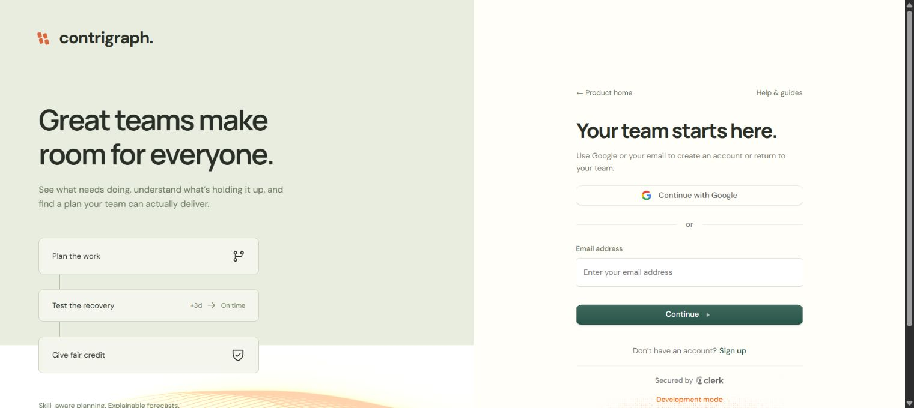
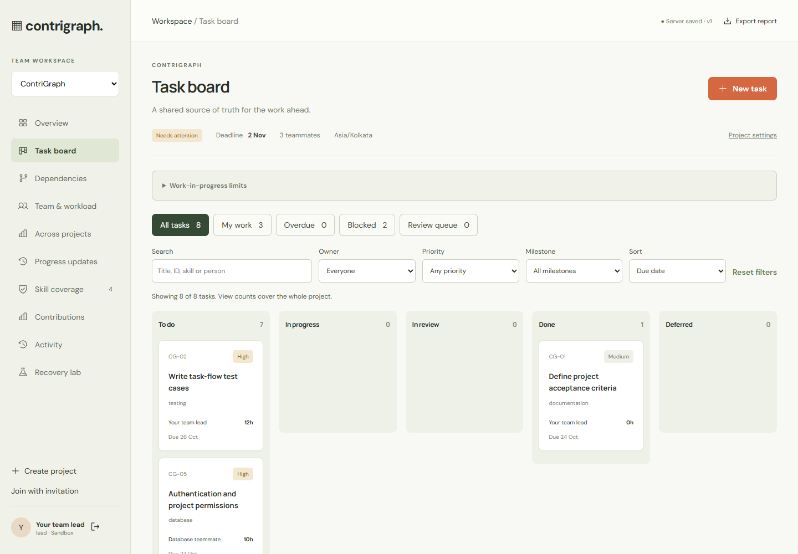
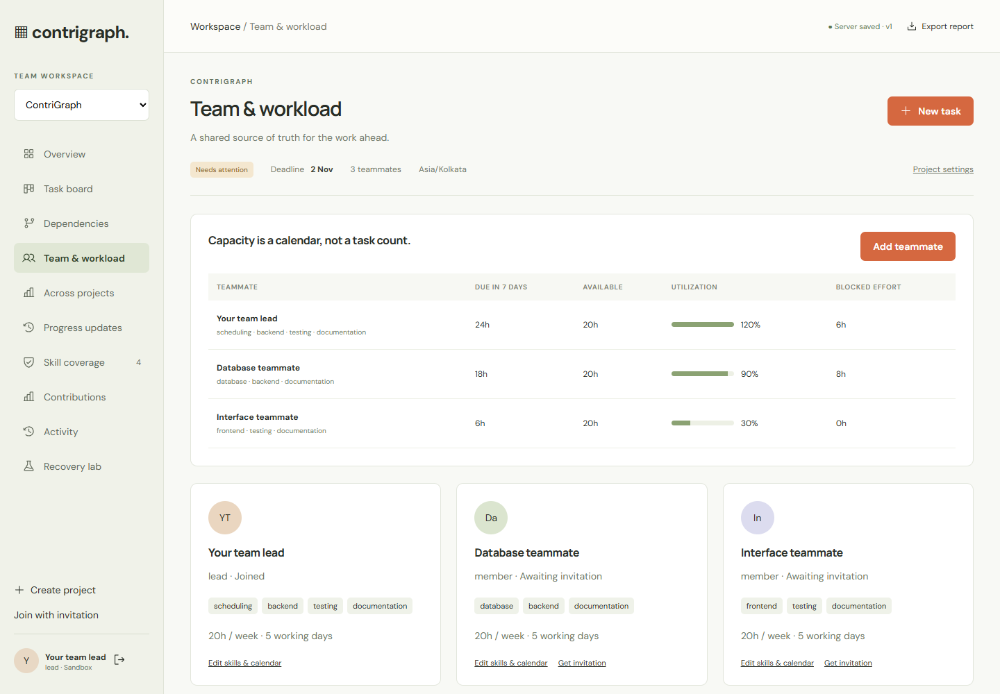
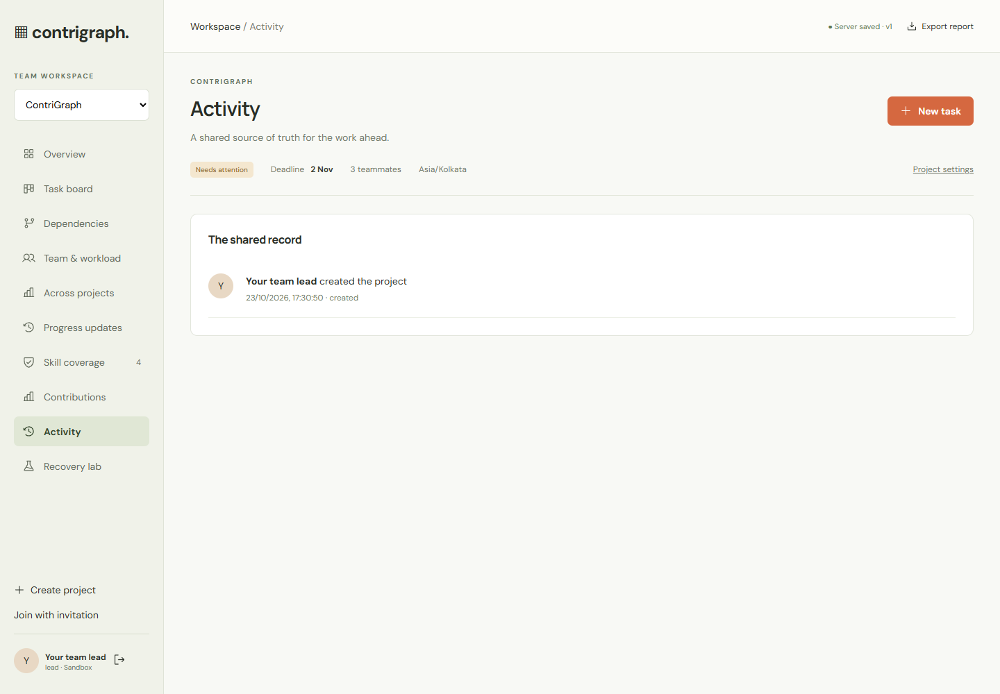
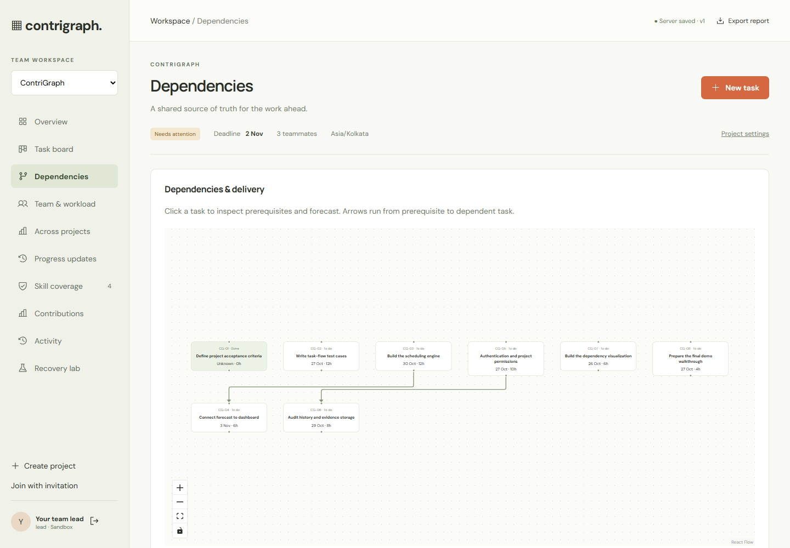
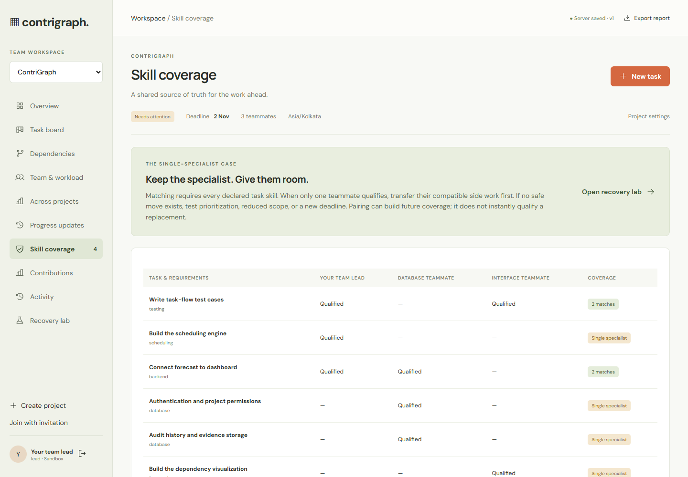
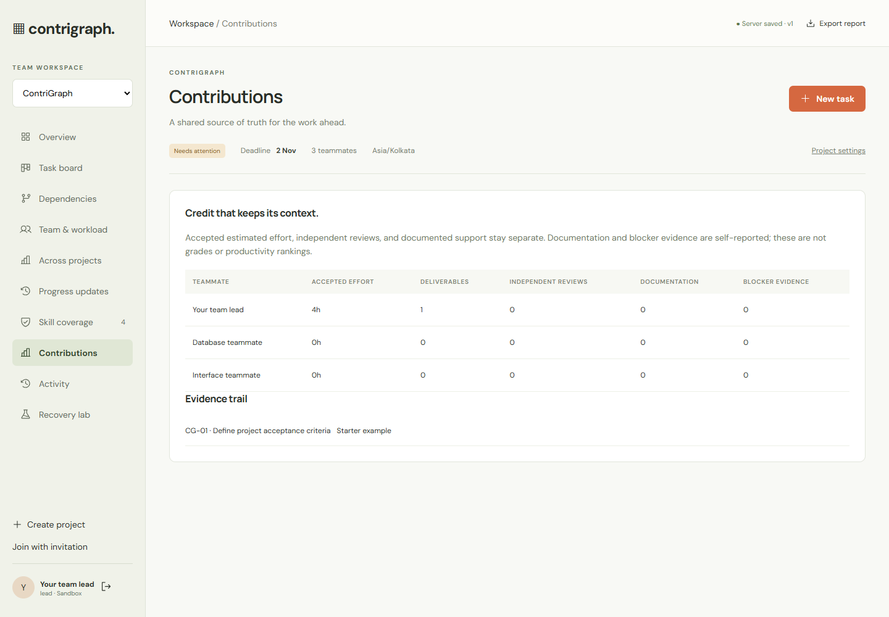
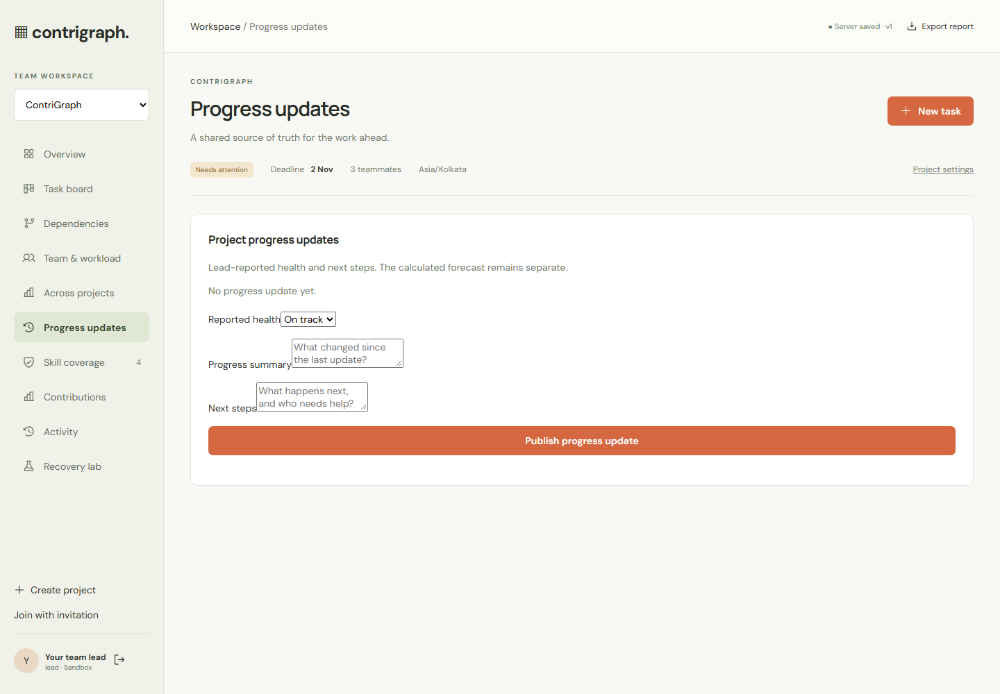
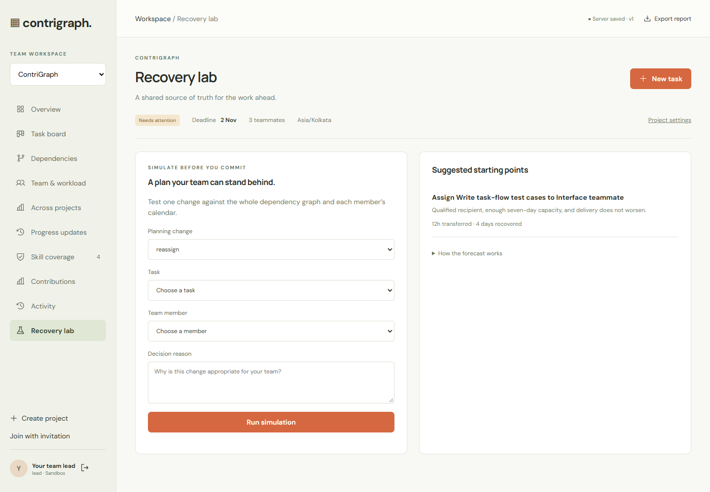
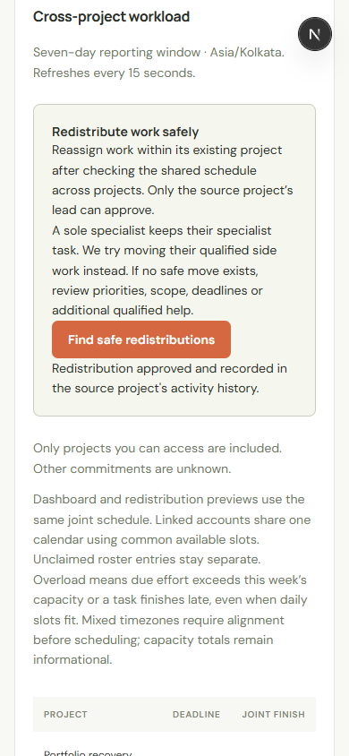

# ContriGraph in use

Captured from the running main application using isolated sample workspaces. No real student accounts, credentials, or private project data are shown. These images document the interface; the GitHub repository does not host a live backend.

## Project overview

Milestone progress, remaining effort, skill risks, and a reviewed recovery path.

## Sign in

Google and verified email authentication through Clerk. Captured on the live site using the current development instance.

## Task board

Task ownership, priorities, deadlines, workflow columns, filters, and advisory WIP limits.

## Project workload

Within-project effort, calendars, and capacity planning.

## Activity history

Server-recorded project changes and decisions.

## Dependencies

The dependency graph makes upstream constraints visible.

## Skill coverage

Single-specialist work remains with a qualified owner.

## Contributions

Contribution evidence combines accepted effort, reviews, and collaboration records without ranking members.

## Progress updates

Leads publish a health assessment, progress summary, and next steps with recorded attribution.

## Recovery lab

Preview a planning decision before applying it.

## Joint workload

All visible projects share each linked person's declared calendar. Project finish dates and daily allocations use the same scheduler as redistribution previews.

## Redistribution preview

The lead reviews before/after dates, protected specialist tasks, and assumptions before entering an approval reason. Viewing the preview does not change assignments.

## Mobile approval

The same approval workflow at a 390-pixel viewport, after a successful persisted reassignment.

