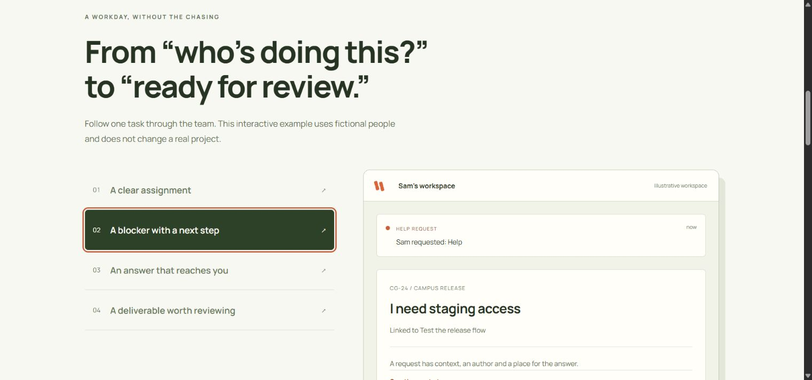
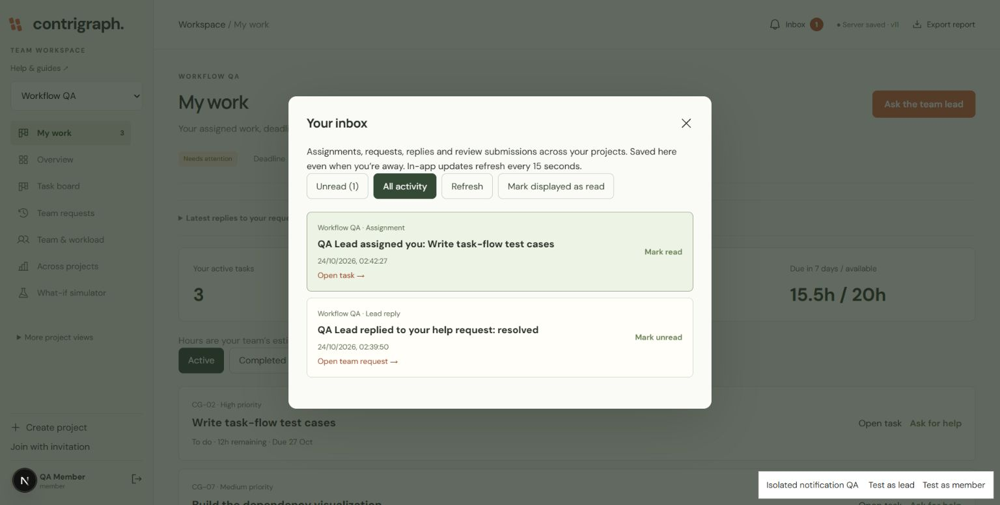
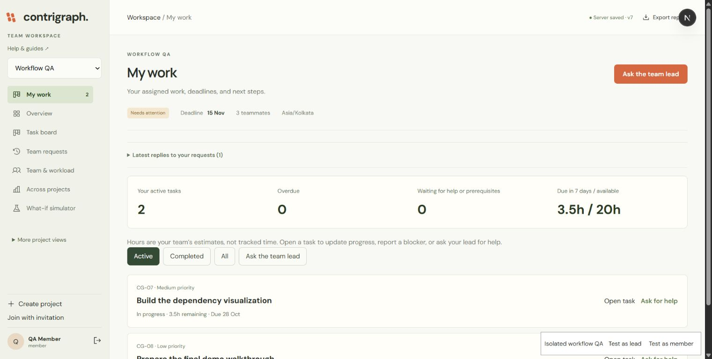
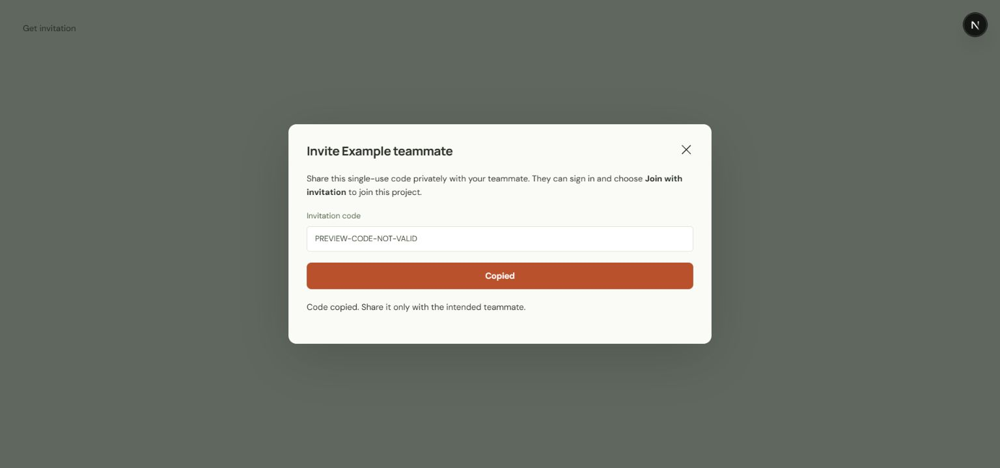
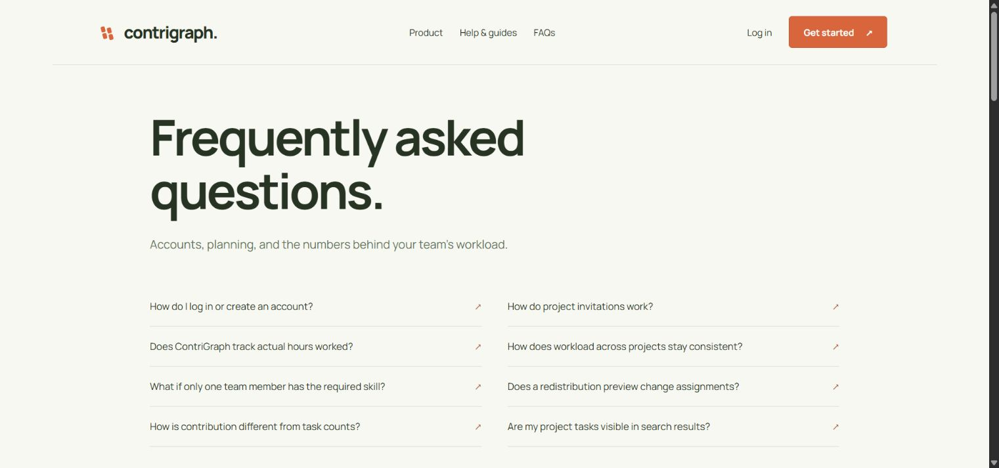

# ContriGraph in use

## Interactive product walkthrough

The live public page explains assignment, help, lead replies and review through a keyboard-accessible example. All people and project details in this walkthrough are fictional.

## Notification inbox

Persisted assignments and lead replies, with read/unread controls and direct navigation. Captured with isolated QA accounts.

Captured from the running main application using isolated sample workspaces. No real student accounts, credentials, or private project data are shown. These images document the interface; the GitHub repository does not host a live backend.

## Project overview

The older overview image below predates the task-first navigation update.

Milestone progress, remaining effort, skill risks, and a reviewed recovery path.

## My work and everyday requests

The current workspace opens on assigned tasks. Members can update remaining effort, report blockers, submit work for review, and request a lead decision. The sidebar fits a normal desktop viewport and scrolls independently when expanded. This screenshot uses an isolated QA account; older gallery images show earlier navigation.

## Sign in

Google and verified email authentication through Clerk. Captured on the live site using the production Clerk instance.

## Task board

Task ownership, priorities, deadlines, workflow columns, filters, and advisory WIP limits.

## Project workload

Within-project effort, calendars, and capacity planning.

## Activity history

Server-recorded project changes and decisions.

## Dependencies

The dependency graph makes upstream constraints visible.

## Skill coverage

Single-specialist work remains with a qualified owner.

## Contributions

Contribution evidence combines accepted effort, reviews, and collaboration records without ranking members.

## Progress updates

Leads publish a health assessment, progress summary, and next steps with recorded attribution.

## Recovery lab

Preview a planning decision before applying it.

## Joint workload

All visible projects share each linked person's declared calendar. Project finish dates and daily allocations use the same scheduler as redistribution previews.

## Redistribution preview

The lead reviews before/after dates, protected specialist tasks, and assumptions before entering an approval reason. Viewing the preview does not change assignments.

## Mobile approval

The same approval workflow at a 390-pixel viewport, after a successful persisted reassignment.

## Teammate invitations

Get invitation opens a dialog with a copy button, visible errors, and single-use sharing instructions. This component preview uses an intentionally invalid example code. Copy/paste and Escape dismissal were verified in Chrome.

# Public FAQs

The live FAQ page with public navigation for Product, Help, FAQs, and Login.

